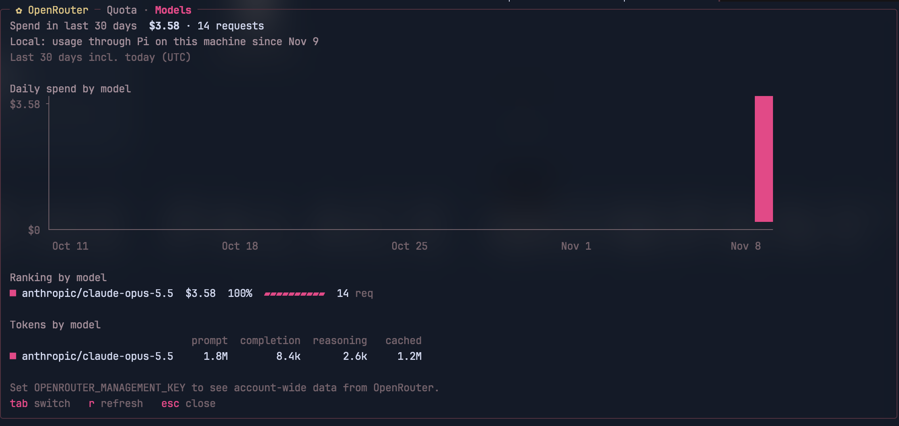
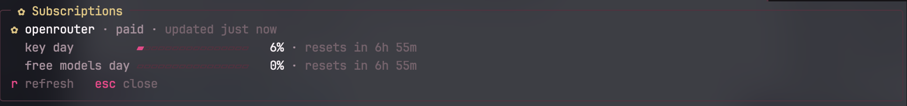
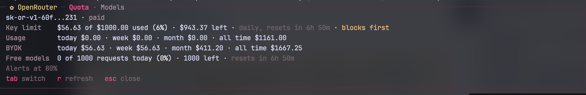
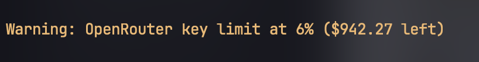

<div align="center">

# ✿ gs-openrouter-quota

**Your OpenRouter quota, spend and per-model usage — inside [Pi](https://pi.dev) and [Gentle Shell](https://github.com/Gentleman-Programming/gentle-shell).**

[](https://gentlemanprogramming.com/gentle-hub/)
[](https://pi.dev)
[](https://nodejs.org)
[](LICENSE)



</div>

## Contents

- [Features](#features)
- [Install](#install)
- [Usage guide](#usage-guide)
  - [1. Quota at a glance with `alt+u`](#1-quota-at-a-glance-with-altu)
  - [2. The dollar detail with `/openrouter`](#2-the-dollar-detail-with-openrouter)
  - [3. Spend per model: the Models tab](#3-spend-per-model-the-models-tab)
  - [4. Threshold alerts](#4-threshold-alerts)
- [Configuration](#configuration)
- [Where the Models data comes from](#where-the-models-data-comes-from)
- [Privacy and security](#privacy-and-security)
- [Limits of what OpenRouter reports](#limits-of-what-openrouter-reports)
- [Development](#development)

## Features

| | |
|---|---|
| 📊 **`alt+u` integration** | OpenRouter joins Gentle Shell's usage view next to Codex, Anthropic and NaN, with percent meters and reset times. |
| 💵 **Quota tab** | Key limit, budgets, daily/weekly/monthly/all-time spend, BYOK usage and free-model requests, in dollars. |
| 📈 **Models tab** | Spend per model over the last 30 days, like OpenRouter's activity page: stacked daily chart, ranking in $ and %, tokens per model. |
| 🔔 **Alerts** | A warning when any limit crosses your threshold, an error when it is exhausted. |
| 🏢 **Works for organization members** | No management key? The Models tab falls back to a local record of your usage through Pi. |

## Install

Pick the command for how you run Pi:

| You use | Install | Update |
|---|---|---|
| **Gentle Shell** | `gentle-shell install git:github.com/asolis87/gs-openrouter-quota` | `gentle-shell update` |
| **Pi** | `pi install git:github.com/asolis87/gs-openrouter-quota` | `pi update` |

`gentle-shell install` runs Pi's own `install` against Gentle Shell's home, so use it when you launch `gentle-shell`; it is the one that enables the `alt+u` integration.

That's it if Pi already talks to OpenRouter (`/login openrouter` or `OPENROUTER_API_KEY`). Requires Node.js 22.19+. Without Gentle Shell everything works except the `alt+u` integration.

## Usage guide

### 1. Quota at a glance with `alt+u`

Use any `openrouter/...` model and press **`alt+u`** in Gentle Shell. OpenRouter shows up in the usage view with one meter per limit:



| Row | What it measures | Resets |
|---|---|---|
| `key` | your API key's credit limit | its `daily` / `weekly` / `monthly` reset, or never |
| `<scope> budget` | each guardrail or workspace budget on the key | the budget's window |
| `free models` | free-model requests today | every UTC day |

The most used limit comes first, so it is the one Gentle Shell's status bar shows. Gentle Shell refreshes it on its own (session start, after responses, and `r` in the view).

> OpenRouter only appears when the session's model, or a subagent route in your profile, is an OpenRouter model.

### 2. The dollar detail with `/openrouter`

Run **`/openrouter`**. A centered panel opens on the **Quota** tab with everything `alt+u` can't show in percentages:



- **Key limit** — spent, total and left, with its reset. `blocks first` marks the limit OpenRouter will enforce first.
- **Budgets** — any guardrail or workspace budget on top of the key limit.
- **Usage / BYOK** — today, this week, this month and all time, for OpenRouter credits and for your own provider keys.
- **Free models** — today's free-model requests.

| Key | Action |
|---|---|
| `tab` | switch between Quota and Models |
| `r` | refresh the active tab |
| `esc` / `q` | close |

Nothing in the panel is sent to the model. In print or JSON mode (no TUI) the Quota report is appended as a card instead.

### 3. Spend per model: the Models tab

Press **`tab`** inside `/openrouter`:


- **Spend in last 30 days** — the total and the request count.
- **Daily spend by model** — one column per day, stacked by model; the top 5 models get their own color and the rest are grouped as `other`.
- **Ranking by model** — spend (BYOK included and marked), share of the total and requests.
- **Tokens by model** — prompt, completion, reasoning and cached tokens.

The header tells you where the numbers come from: the whole OpenRouter account, or your usage through Pi on this machine. See [Where the Models data comes from](#where-the-models-data-comes-from).

### 4. Threshold alerts

Every time `/openrouter` loads the quota (on open and on `r` in the Quota tab), each limit at or above the threshold raises a warning:



An exhausted limit (nothing left) raises an error instead. The default threshold is 80%. Change it with `OPENROUTER_QUOTA_ALERT_PERCENT` when you start Pi:

```bash
OPENROUTER_QUOTA_ALERT_PERCENT=90 pi   # alert at 90%
OPENROUTER_QUOTA_ALERT_PERCENT=0 pi    # alerts off
```

## Configuration

Everything is optional and set through environment variables.

| Variable | Default | Purpose |
|---|---|---|
| `OPENROUTER_API_KEY` | — | Inference key, used only when Pi has no OpenRouter credential of its own. |
| `OPENROUTER_QUOTA_ALERT_PERCENT` | `80` | Alert threshold: `1`–`100`, or `0` to turn alerts off. Anything else falls back to 80. |
| `OPENROUTER_MANAGEMENT_KEY` | — | Makes the Models tab show account-wide data. See below. |
| `PI_CODING_AGENT_DIR` | `~/.pi/agent` | Pi's own setting; moves the local ledger with it. |

The inference key is resolved from Pi's `openrouter` credential first (`/login openrouter`), then `OPENROUTER_API_KEY`.

## Where the Models data comes from

| `OPENROUTER_MANAGEMENT_KEY` | Source | Covers | Window |
|---|---|---|---|
| set | `GET /api/v1/activity` | the whole account: every app, machine and member key it can see | 30 **completed** UTC days (today's spend is on the Quota tab) |
| unset | the local ledger | usage through Pi on this machine, subagents included | last 30 days **including today** |

### Management key

OpenRouter only serves per-model activity to a **management key**, not to the inference key you use for models. If you can create one:

1. Open [OpenRouter → Settings → Management Keys](https://openrouter.ai/settings/management-keys) and click **Create New Key** (copy it: it is shown once).
2. `export OPENROUTER_MANAGEMENT_KEY=sk-or-v1-...` and restart Pi.

Both kinds of key start with `sk-or-v1-`; if the Models tab answers HTTP 401/403, you pasted an inference key.

> Organization members usually can't create management keys — ask an admin, or just use the local ledger.

### Local ledger

Without a management key, every OpenRouter response made through Pi is appended to `~/.pi/agent/openrouter-quota/ledger.jsonl`: generation id, time, model, cost, BYOK (when known) and token counts.

- **Cost** — what OpenRouter billed, as reported to Pi. When Pi only has a catalog estimate, the package asks `GET /api/v1/generation?id=<id>` once, about 3 s later, for the billed cost. If that fails, the estimate stays and the header counts it as `estimated`.
- **Retention** — entries older than 30 days are ignored; the file is compacted at session start once it passes 512 KB.
- **Starts empty** — history begins when you install the package. Usage from other apps, machines or the OpenRouter website is not included.

## Privacy and security

- **Keys** are never stored, logged or shown. The inference key goes only to `/api/v1/key` and `/api/v1/generation`; the management key only to `/api/v1/activity`.
- **Fixed URLs** — the package can only request `https://openrouter.ai/api/v1/key`, `/api/v1/activity`, and `/api/v1/generation` with a single validated `id`. Anything else is refused.
- **The local ledger** stays on your machine and holds no keys, prompts or message content.
- **A management key can create, change and delete your API keys.** This package only uses it for one read-only `GET`, but treat it as a secret and give it an expiration.

## Limits of what OpenRouter reports

- Request rate limits are not exposed ahead of time: OpenRouter only sends `X-RateLimit-*` headers on rate-limit errors.
- The account balance itself is not part of `/api/v1/key`; the key limit and budgets are what block requests.
- `/api/v1/activity` excludes the current UTC day.

## Development

```bash
npm install
npm test           # node:test with type stripping, no build step
npm run typecheck  # tsc --strict
```

Listed on [Gentle Hub](https://gentlemanprogramming.com/gentle-hub/) through the GitHub topics `gentle-shell-package` and `gentle-shell-extension`.

## License

[MIT](LICENSE)
